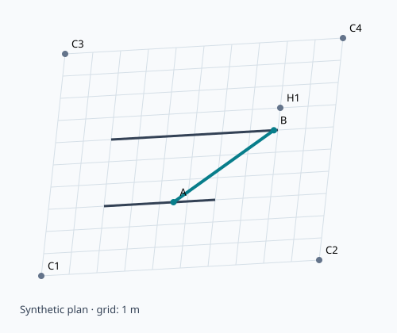

# Coordinate Plan Overlay

An agent skill for drawing measured lines, points, offsets, and grids over an existing
survey, cadastral, engineering, or site plan. Calculate the geometry in world coordinates
first, then project it onto the plan and check the result against separate reference points.



## Quick start

For an agent that supports skills, install this folder as `coordinate-plan-overlay` using
your agent's skill installation method. The entry point is [SKILL.md](SKILL.md). For example:

> Use Coordinate Plan Overlay on my plan. Place the start 2.5 m along the first finite
> segment, then draw a 4.5 m line that ends on the second finite segment. Use separate
> check points for calibration and show all possible endpoints if there is more than one.

The geometry helper works without an agent. With Python 3 and NumPy installed:

```sh
python scripts/geometry.py < examples/synthetic_calibration.json
python examples/synthetic_overlay.py ./example-output
python -m unittest discover -s tests -v
```

See the [synthetic example](examples/README.md) for the generated plan, overlay, and
verification report. The deliberately bad fit is flagged as provisional.

## What the checks do

- Use fitted and withheld points to check the plan's scale, orientation, and alignment.
- Reject unstable fits; mark missing, reused, or out-of-tolerance checks as provisional.
- Distinguish a finite segment, a ray, and an infinite line. Keep every valid solution
  when the input does not determine a unique endpoint.

Numerical checks do not establish survey accuracy or legal boundaries. Verify point
identity, coverage, and the rendered result before relying on a real overlay. All
example inputs are synthetic.

## License

[MIT](LICENSE).
